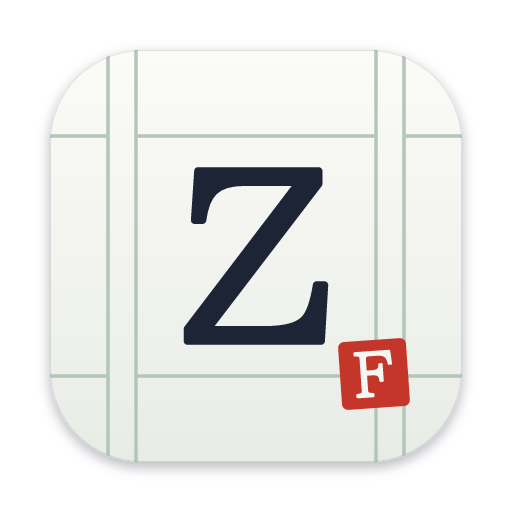
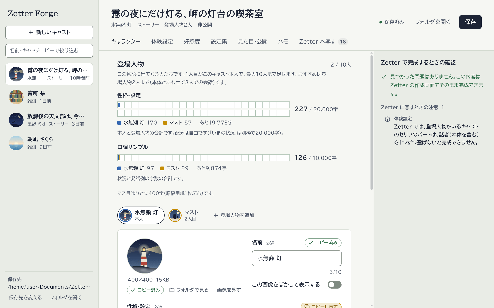
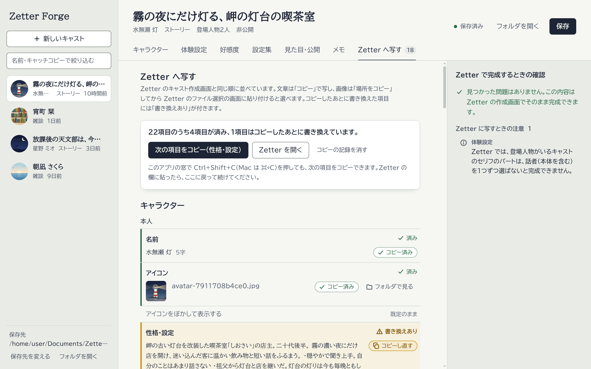
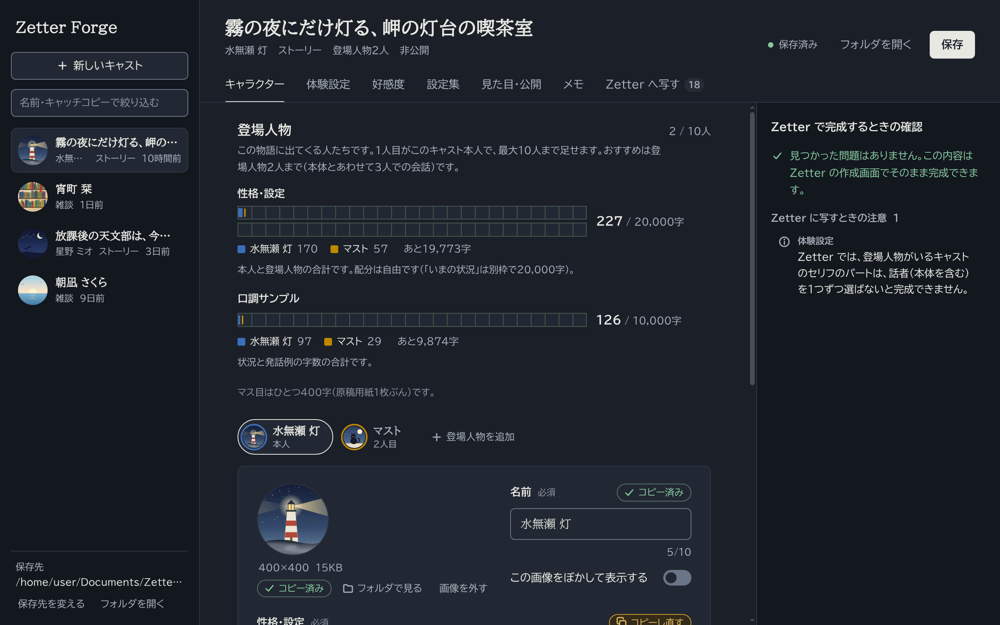

# Zetter Forge

Zetter のキャスト設定をパソコンに保存して、手元で書き直すためのデスクトップアプリです。Zetter に載せる前の下書き、載せたあとの控え、手元での改良に使います。

Zetter のキャスト作成画面と同じ項目・同じ上限で書けます。右側の「Zetter で完成するときの確認」に、Zetter で止められる点や保存されない点が出ます。

「Zetter へ写す」のタブでは、Zetter の作成画面と同じ順に1項目ずつコピーできます。コピーしたあとに書き換えた項目も分かります。

パソコンの設定に合わせて、暗い色の画面にもなります。
